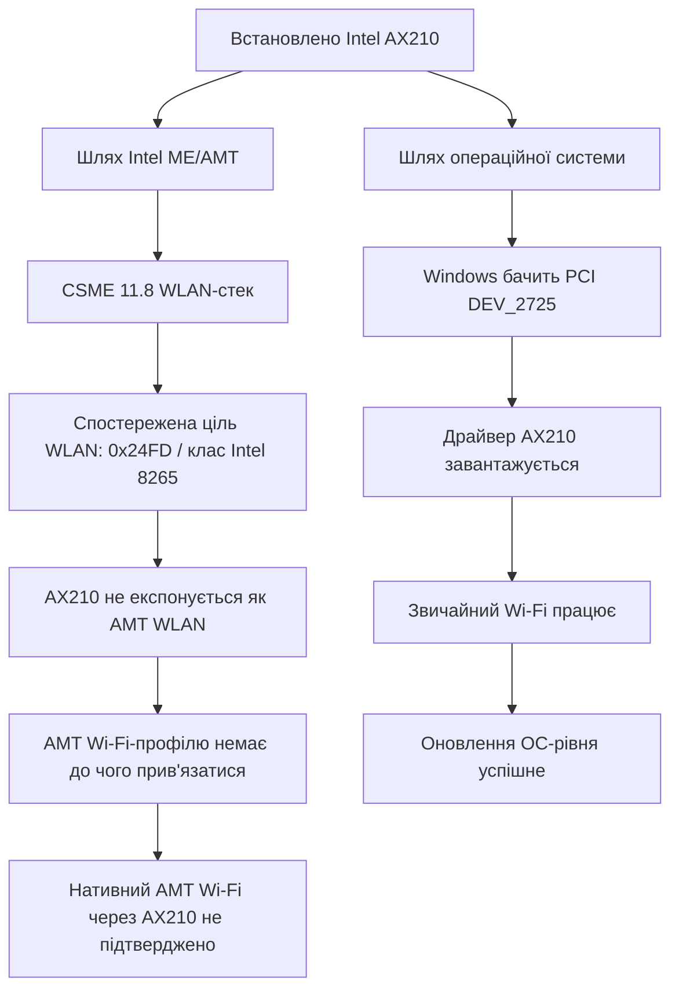
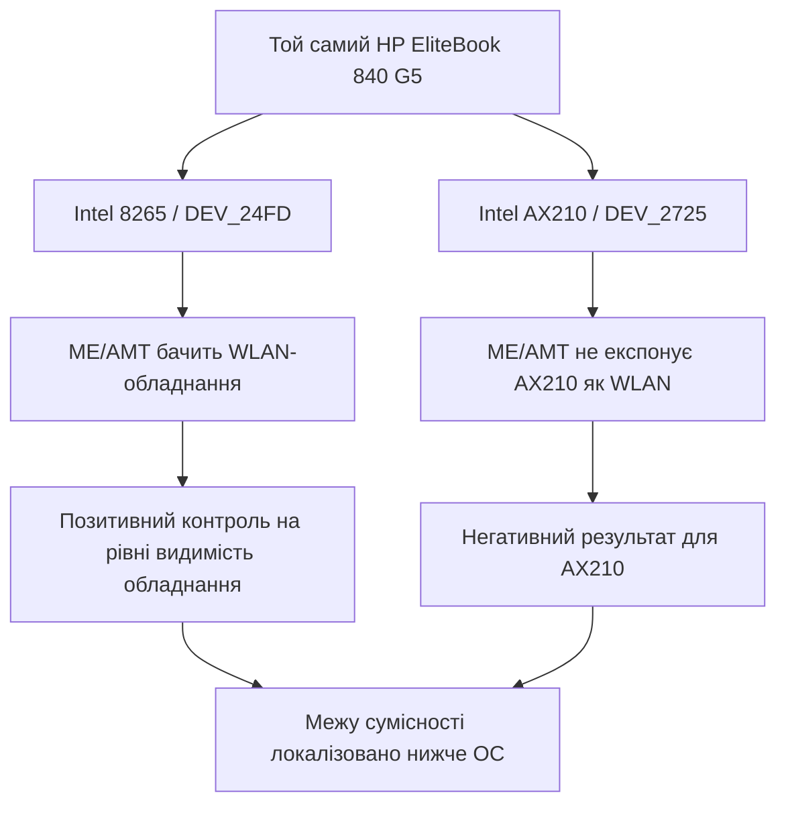
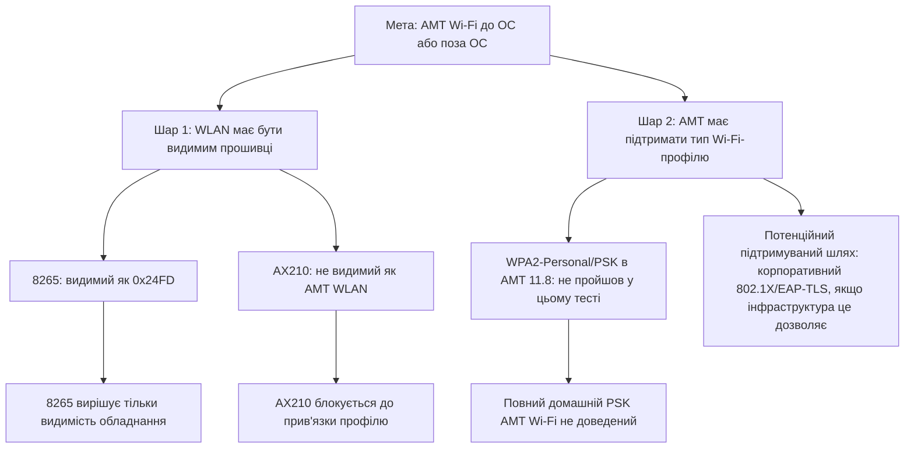
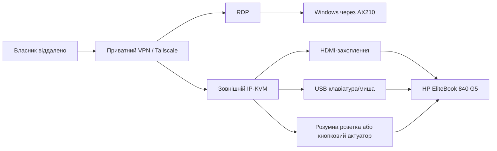

# HP EliteBook 840 G5 + Intel AX210 + AMT Wi-Fi: дослідження сумісності

Мовне видання: українська

Англійська версія: https://github.com/Tarasevych/hp-elitebook-840-g5-ax210-amt-wifi-compatibility-English

Цей репозиторій документує практичне дослідження сумісності: у власному HP EliteBook 840 G5 штатний WLAN-модуль покоління Intel vPro було замінено на Intel Wi-Fi 6E AX210. Операційна система прийняла оновлення, але Intel ME/AMT не показала AX210 як позасмуговий Wi-Fi-пристрій для керування до запуску ОС або поза ОС.

Головний висновок: заміна Wi-Fi-модуля має два різні рівні сумісності. AX210 працює як звичайний Wi-Fi у Windows, але не стає автоматично AMT/OOB Wi-Fi-інтерфейсом у прошивці HP Q78 / Intel CSME 11.8.

| Рівень сумісності | Питання | Результат у цьому випадку |
| --- | --- | --- |
| Сумісність ОС із WLAN | Чи бачить і використовує Windows AX210? | Так |
| Сумісність прошивки керування | Чи може Intel ME/AMT використати AX210 до або поза ОС? | Локальні докази цього не підтвердили |
| Практичне віддалене адміністрування Windows | Чи можна керувати Windows через Wi-Fi? | Так, через приватний VPN/Tailscale + RDP |
| BIOS/pre-OS/off-state | Чи можна отримати контроль без працюючої Windows? | Практичний маршрут: зовнішній IP-KVM + керування живленням |

Повний звіт: [docs/звіт-сумісності.md](docs/звіт-сумісності.md)

Підсумок закриття випадку: [docs/закриття-випадку.md](docs/закриття-кейсу.md)

Огляд меж AI-допомоги в ремонтних задачах: [docs/межі-ai-допомоги-в-ремонті.md](docs/межі-ai-допомоги-в-ремонті.md)

## Дослідницьке питання

Чи може сучасний Intel AX210, встановлений у HP EliteBook 840 G5 з HP Q78 / Intel CSME 11.8, працювати як нативний Intel AMT Wi-Fi-інтерфейс для позасмугового керування?

Додаткові питання:

- Чи проблема виникає у драйвері Windows, чи нижче за ОС?
- Чи бачить ME/AMT встановлений AX210 як WLAN-обладнання для керування?
- Чи підтверджується робота штатного WLAN-рівня з модулем класу 8265/8260?
- Яка підтримувана архітектура все одно дає власнику доступ до Windows, BIOS/pre-OS і стану вимкненого ПК?

## Короткий метод

| Крок | Навіщо він потрібен | Результат |
| --- | --- | --- |
| Перевірка Windows-обладнання | Підтвердити, що AX210 фізично встановлений і видимий ОС | AX210 видно як Intel Wi-Fi 6E AX210 / `VEN_8086&DEV_2725` |
| Перевірка драйвера | Відділити проблему ОС від проблеми прошивки | Драйвер Windows наявний, Wi-Fi працює |
| Перевірка ME/AMT | Побачити, що бачить прошивка керування | AMT показує ціль WLAN класу 8265, а AX210 не експонується як AMT WLAN |
| Контроль з Intel 8265 | Відділити несумісність AX210 від загальної помилки AMT | 8265 бачиться ME/AMT як WLAN-обладнання |
| Перевірка AMT Wi-Fi-профілю | З'ясувати, чи достатньо повернути штатну карту | WPA2-Personal/PSK не прийнято в AMT 11.8 у цьому тесті |
| Практична архітектура доступу | Зберегти початкову мету без залежності від непідтриманої прошивки | AX210 для Windows; IP-KVM + живлення для BIOS/pre-OS/off-state |

## Головна причинно-наслідкова схема



Це ключове інженерне розділення: драйвер ОС і WLAN-стек Intel ME/AMT є різними доменами сумісності.

## Знімок доказів

| Доказ | Спостереження | Значення |
| --- | --- | --- |
| Ноутбук | HP EliteBook 840 G5 | Цільова платформа |
| BIOS | HP Q78 Ver. 01.31.00 | Поточна прошивка платформи в цьому випадку |
| ME/CSME | Intel CSME 11.8.97.4739 LP | Покоління прошивки, яке тестувалося |
| Новий WLAN | Intel Wi-Fi 6E AX210 160MHz | Модуль, який працює в ОС |
| Windows PCI ID | `VEN_8086&DEV_2725` | AX210 видимий Windows |
| AMT WLAN-ціль | `0x24FD` / Intel Dual Band Wireless-AC 8265 | Прошивка вказує на старий клас WLAN |
| AMT WLAN-обладнання з AX210 | Повідомлення AMT: Intel WLAN не встановлено (`Intel WLAN card not installed`) | ME/AMT не бачить AX210 як OOB WLAN |
| Контроль з 8265 | ідентифікатор бездротового обладнання `0x24FD` | Платформа може бачити підтримуваний WLAN на рівні ME/AMT |

## Чому негативний результат корисний

Дослідження не довело роботу нативного AMT Wi-Fi через AX210 на HP Q78 / CSME 11.8. Це не провал, а основний результат: він звужує проблему до конкретного шару сумісності.

| Гіпотеза | Результат | Що це відсікає |
| --- | --- | --- |
| AX210 встановлений неправильно | Ні | Windows бачить і використовує модуль |
| Це проблема драйвера Windows | Ні | ОС-рівень працює |
| AMT може використати будь-який Intel WLAN, якщо він працює в ОС | Не підтверджено | ME/AMT не бачить AX210 як WLAN |
| Достатньо додати Wi-Fi-профіль в AMT | Ні для AX210 | Немає AMT WLAN-цілі, прив'язаної до AX210 |
| Повернення до 8265 автоматично доводить повний домашній AMT Wi-Fi | Ні | 8265 бачиться прошивкою, але WPA2-Personal/PSK не пройшов в AMT 11.8 |
| Для практичного контролю обов'язково потрібен AMT-over-AX210 | Ні | IP-KVM закриває BIOS/pre-OS/off-state рівень |

## Контрольний експеримент

Найважливіше уточнення: ми не можемо просто сказати, що причина тільки в заміні плати, доки не перевіримо підтримувану плату на тому самому ноутбуці.



| Та сама машина | WLAN-модуль | Результат ME/AMT | Наукове значення |
| --- | --- | --- | --- |
| HP 840 G5 / Q78 / CSME 11.8 | Intel 8265 / `DEV_24FD` | ME/AMT показує ідентифікатор бездротового обладнання `0x24FD` | Позитивний контроль видимості WLAN у прошивці |
| HP 840 G5 / Q78 / CSME 11.8 | Intel AX210 / `DEV_2725` | ME/AMT не показує AX210 як встановлений WLAN | Межа сумісності для AX210 |

Але контроль має межу: 8265 підтверджує видимість WLAN у ME/AMT, а не повний домашній AMT Wi-Fi через WPA2-Personal/PSK. У тесті AMT 11.8 не прийняв WPA2-Personal/PSK-профіль, тому повний pre-OS/off-state Wi-Fi-сценарій для домашньої мережі не доведений навіть з 8265.

## Двошарова модель проблеми



Висновок двоскладовий:

```text
Проблема AX210:
  ME/AMT не експонує AX210 як позасмуговий WLAN-пристрій.

Проблема домашнього WPA2-Personal:
  AMT 11.8 не прийняв PSK-профіль навіть з 8265 у цьому тесті.
```

## Практична архітектура рішення

Замість того щоб змушувати AX210 стати AMT WLAN-пристроєм, практичніше розділити задачу за рівнями.



| Мета | Практичний маршрут | Чому саме так |
| --- | --- | --- |
| Адміністрування Windows | AX210 + Tailscale/VPN + RDP | Використовує робочий Wi-Fi-шлях ОС |
| BIOS / меню завантаження / відновлення | Зовнішній IP-KVM | Не залежить від підтримки AX210 у ME/AMT |
| Клавіатура до запуску ОС | USB HID через IP-KVM | Працює на рівні введення, якщо BIOS приймає USB |
| Увімкнення після вимкнення | Розумна розетка (smart plug) + Wake on AC або фізичний актуатор кнопки | Обходить залежність від нативного AMT-over-Wi-Fi |
| Публікація результатів | Санітизовані таблиці й висновки | Дає користь виробникам без витоку приватних даних |

## Порівняння можливих маршрутів

| Маршрут | Що вирішує | Що не вирішує | Поточний статус |
| --- | --- | --- | --- |
| Офіційне підписане оновлення HP/Intel | Могло б додати нативний AX210 AMT Wi-Fi | Такого шляху не знайдено в доказах | Найкращий виробничий результат |
| Офіційна заява про обмеження | Знімає невизначеність | Не додає функціональності | Дуже корисно для користувачів |
| Повернення до 8265/8260 | Відновлює видимість WLAN у ME/AMT | Не доводить WPA2-Personal/PSK AMT Wi-Fi на AMT 11.8 | Корисний контрольний шлях |
| Міст Wi-Fi-to-Ethernet | Дає AMT через дротовий шлях із Wi-Fi uplink (висхідним Wi-Fi-каналом) | Це не нативний AX210 AMT Wi-Fi | Практичний резервний маршрут |
| IP-KVM + керування живленням | Дає BIOS/pre-OS/off-state контроль | Не робить AX210 AMT-сумісним | Рекомендований практичний маршрут |

## Чому це важливо для виробників

| Учасник | Урок із випадку | Практична дія |
| --- | --- | --- |
| Виробники ноутбуків | Замінний WLAN не означає замінну керованість | Публікувати окремо сумісність WLAN на рівні ОС і сумісність AMT/OOB WLAN |
| Власники прошивкової ME-платформи | Покоління CSME і покоління WLAN мають збігатися | Документувати підтримку WLAN за CSME-поколінням |
| Розробники драйверів | Робочий драйвер ОС може маскувати нижчу несумісність | Додавати діагностику, що відрізняє Wi-Fi на рівні ОС від AMT Wi-Fi |
| IT-адміністратори | Масове оновлення парку пристроїв може зберегти Wi-Fi, але зламати керованість | Тестувати OOB WLAN до масової заміни модулів |
| Ремонтна спільнота | Негативний результат теж має цінність | Збирати санітизовані матриці замість чуток |
| Політика ремонтопридатності | Прихована зв'язка прошивки збільшує електронні відходи | Вимагати документації сумісності прошивки як частини ремонтопридатності |

## Що могло б закрити випадок

| Доказ або дія | Наслідок |
| --- | --- |
| Офіційний підписаний HP/Intel шлях для AX210 AMT WLAN на Q78 / CSME 11.8 | Нативне рішення прошивки |
| Офіційне підтвердження, що AX210 не підтримується цим поколінням CSME/платформи | Чітка межа підтримки |
| Незалежні повторення "AX210 негативний / 8265 позитивний" на інших 840 G5 | Сильніша база для виробника |
| Доведений підтримуваний профіль AMT 11.8 з 8265 | Ясність щодо того, чи можливий штатний AMT Wi-Fi без PSK |
| Документована зовнішня IP-KVM схема | Практичне рішення для користувачів без модифікації прошивки |

## Підтверджувальні матеріали

- [docs/звіт-сумісності.md](docs/звіт-сумісності.md) — повний технічний звіт.
- [docs/підсумок-доказів.md](docs/підсумок-доказів.md) — санітизований підсумок доказів.
- [docs/матриця-сумісності.md](docs/матриця-сумісності.md) — матриця сумісності.
- [docs/журнал-дослідів.md](docs/журнал-дослідів.md) — журнал дослідів.
- [docs/практичний-маршрут.md](docs/практичний-маршрут.md) — підтримуваний практичний маршрут.
- [docs/запит-до-виробника.md](docs/запит-до-виробника.md) — запит до виробника.
- [docs/критерії-виробничого-рішення.md](docs/критерії-виробничого-рішення.md) — критерії прийнятного виробничого рішення.
- [docs/шаблон-відтворення.md](docs/шаблон-відтворення.md) — шаблон для інших власників.
- [docs/запрошення-до-повторення.md](docs/запрошення-до-повторення.md) — запрошення до незалежного повторення.
