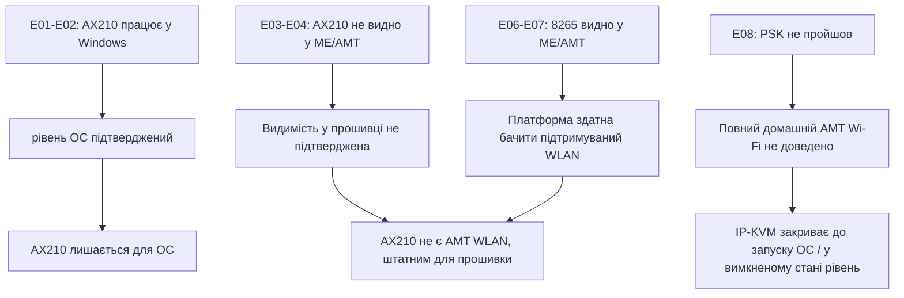

# Журнал дослідів

| ID | Дослід | Спостережений результат | Стан |
| --- | --- | --- | --- |
| E01 | Встановлення AX210 і запуск Windows | AX210 визначений як Intel Wi-Fi 6E AX210 | Пройдено |
| E02 | Перевірка драйвера AX210 | Драйвер 24.50.0.4, Wi-Fi працює | Пройдено |
| E03 | Перевірка ME/AMT WLAN з AX210 | AMT не показує AX210 як Intel WLAN | Негативний результат |
| E04 | Перевірка WLAN-цілі в прошивці | Виявлено `0x24FD` / клас Intel 8265 | Підтверджено стару ціль |
| E05 | Пошук шляху підтримки AX210 того самого покоління | Підтверджений CSME 11.8 AX210 шлях не знайдено | Негативний результат |
| E06 | Встановлення Intel 8265 для контролю | Windows бачить 8265, Wi-Fi працює | Пройдено |
| E07 | ME/AMT WLAN з 8265 | AMT показує ідентифікатор бездротового обладнання `0x24FD` | Позитивний контроль |
| E08 | AMT WPA2-Personal/PSK-профіль з 8265 | Створення профілю не пройшло | Негативний результат другого шару |
| E09 | Архітектура практичного доступу | AX210 для Windows, IP-KVM для BIOS / до запуску ОС / у вимкненому стані | Рекомендовано |

## Інтерпретація

