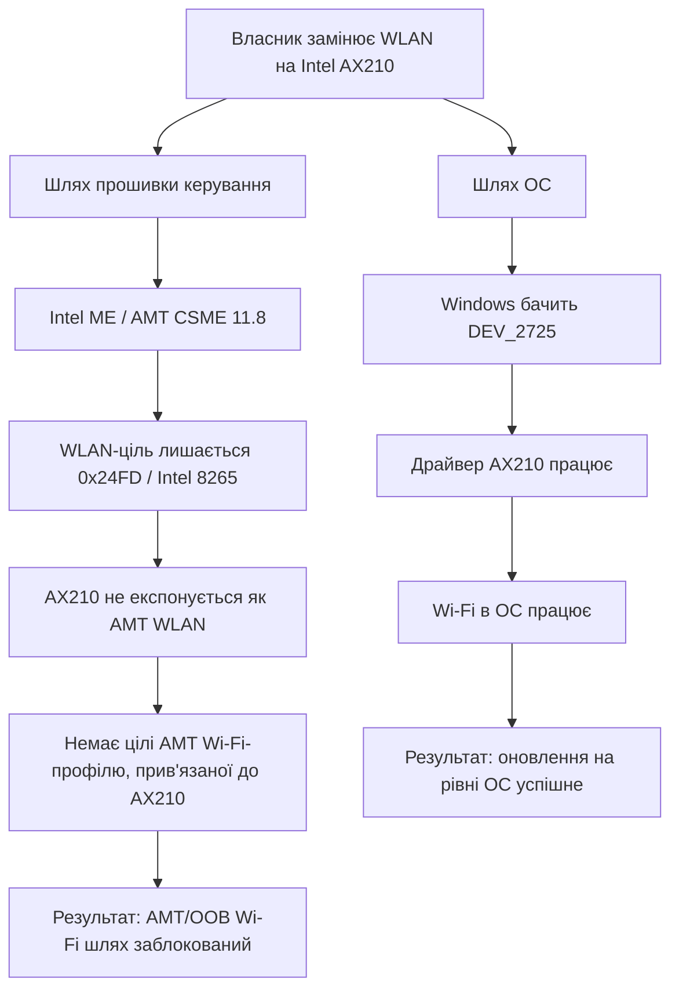
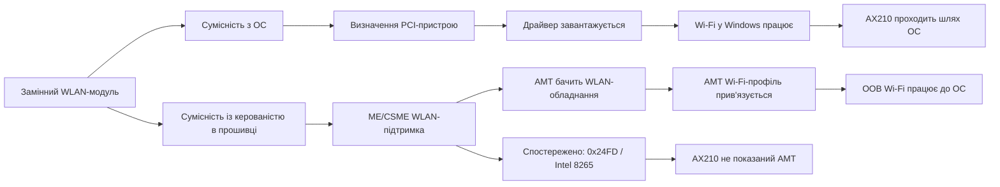
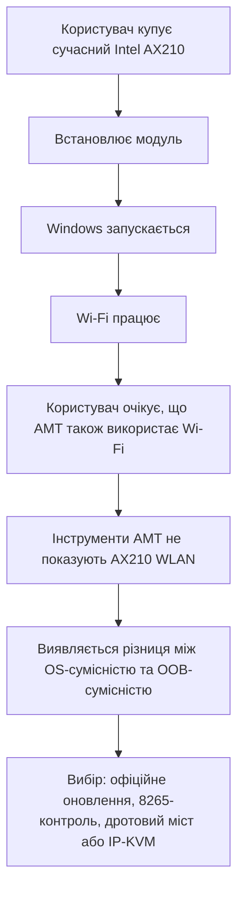
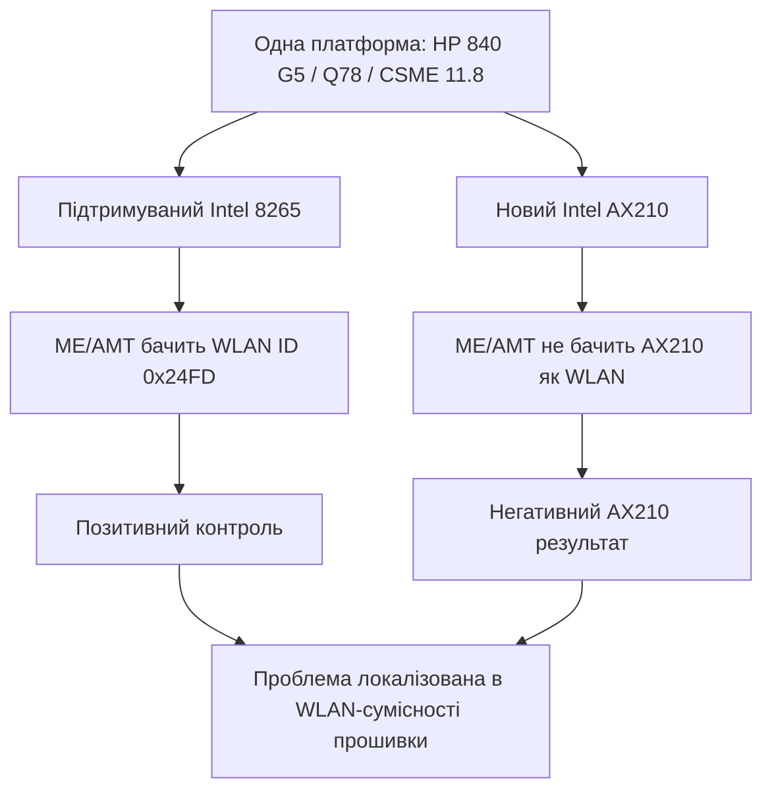
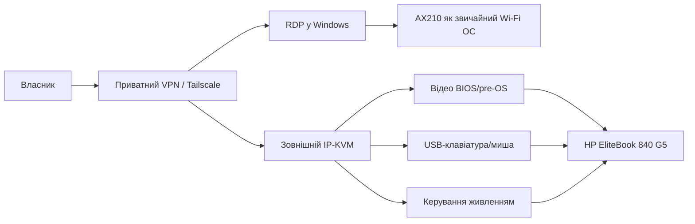

# HP EliteBook 840 G5 + Intel AX210: чому Windows Wi-Fi працює, а AMT/OOB Wi-Fi ні

Мовне видання: українська

Англійська версія: https://github.com/tarasevychp/hp-elitebook-840-g5-ax210-amt-wifi-compatibility-English

Статус: `ТЕХНІЧНЕ_ДОСЛІДЖЕННЯ_СУМІСНОСТІ`

Дата: 2026-07-09

## Анотація

Ця стаття документує практичне дослідження сумісності власного HP EliteBook 840 G5 після заміни WLAN-модуля покоління Intel vPro на Intel Wi-Fi 6E AX210.

Оновлення працює нормально в Windows: ОС бачить AX210, завантажує драйвер Intel і використовує модуль як звичайний Wi-Fi-адаптер. Проблема з'являється нижче операційної системи, у шарі Intel ME/AMT out-of-band management. На цій платформі Intel CSME 11.8 / HP Q78 прошивка показує старішу WLAN-ціль для класу Intel Dual Band Wireless-AC 8265, але не експонує AX210 як AMT-керований бездротовий інтерфейс.

Практичний результат:

- Windows Wi-Fi: працює з AX210.
- Віддалене адміністрування Windows: працює через приватний VPN/Tailscale + RDP.
- Нативний Intel AMT Wi-Fi OOB з AX210: не підтверджено локальними доказами.
- BIOS/pre-OS/off-state доступ через Wi-Fi-only середовище: практично реалізовується зовнішнім IP-KVM і окремим керуванням живленням, якщо HP/Intel не нададуть офіційний підписаний шлях прошивки.

Це питання ремонтопридатності й електронних відходів: обладнання фізично оновлюється, але нижчий рівень керованості лишається прив'язаним до матриці прошивки WLAN свого покоління.

## Межі дослідження

Робота виконувалась як дослідження сумісності під контролем власника пристрою. Вона фокусується на діагностиці, доказах і підтримуваній архітектурі доступу.

| Область | Використаний підхід |
| --- | --- |
| Діагностика | Лише для читання перевірки й вихідні дані підтримуваних інструментів |
| Адміністрування Windows | Tailscale/приватний VPN + RDP |
| AMT | Штатні режими AMT з автентифікованим локальним доступом |
| BIOS/pre-OS/off-state | Зовнішній IP-KVM + контрольований власником метод живлення |
| Публікація доказів | Санітизовані таблиці без паролів, Wi-Fi-ключів, приватних IP, MAC, серійних номерів або ключів відновлення |

Мета не в тому, щоб приховати обмеження, а в тому, щоб відділити підтримувані факти від припущень і дати виробникам перевірний формат проблеми.

## Дослідницьке питання

Чи може Intel AX210, встановлений у HP EliteBook 840 G5 з HP Q78 / Intel CSME 11.8, бути використаний як нативний Intel AMT out-of-band Wi-Fi-інтерфейс?

Похідні питання:

- Чи проблема знаходиться в Windows-драйвері?
- Чи бачить ME/AMT AX210 як WLAN-пристрій для керування?
- Чи відтворюється видимість ME/AMT з модулем Intel 8265?
- Чи достатньо повернути підтримуваний WLAN-модуль, щоб отримати повний AMT Wi-Fi у домашній WPA2-Personal мережі?
- Який підтримуваний маршрут дає практичний доступ до Windows і BIOS/pre-OS/off-state рівнів без залежності від непідтвердженого шляху прошивки?

## Методологія

Дослідження виконувалося як послідовність лише для читання перевірок і контрольних експериментів.

| Метод | Призначення | Клас доказів |
| --- | --- | --- |
| Перевірка Windows-обладнання | Підтвердити, що AX210 встановлений і видимий ОС | PnP / PCI / драйвер |
| Перевірка ME/AMT | Порівняти WLAN, який бачить ОС, із WLAN, який бачить прошивка | MEInfo/AMT-статуси |
| Контроль з Intel 8265 | Перевірити, чи платформа взагалі здатна показати WLAN у ME/AMT | A/B тест на тій самій машині |
| Перевірка AMT Wi-Fi-профілю | Відокремити видимість обладнання від сумісності профілю | Результат прив'язки AMT-профілю |
| Проектування доступу | Зберегти практичну мету власника | VPN/RDP, IP-KVM, модель перевірки керування живленням |

Негативний результат є валідним результатом, бо він показує точний шар, де сумісність обривається.

## Візуальний підсумок



## Таблиця результатів

| Рівень | Що перевіряється | Локальний результат | Значення |
| --- | --- | --- | --- |
| Фізична заміна | Чи встановлено AX210 | Виконано | Модуль фізично придатний для системи |
| Windows модель пристроїв | Чи бачить ОС AX210 як PCI Wi-Fi | Успішно | Windows бачить `VEN_8086&DEV_2725` |
| Драйвер Windows | Чи працює AX210 як звичайний Wi-Fi | Успішно | ОС-рівень не є коренем проблеми |
| Intel ME/AMT WLAN | Чи може прошивка використати WLAN для OOB | Невдало для AX210 | AX210 не експонується як керований WLAN |
| AMT Wi-Fi-профіль | Чи є інтерфейс, до якого можна прив'язати профіль | Для AX210 немає | Профіль не виправляє відсутність WLAN, видимого для прошивки |
| Контроль з 8265 | Чи бачить прошивка підтримуваний WLAN | Успішно на рівні видимості | Платформа може бачити WLAN, але не AX210 |
| Домашній WPA2-Personal AMT Wi-Fi | Чи працює PSK-профіль в AMT 11.8 | Не пройшов у тесті | Повернення до 8265 не доводить повний домашній AMT Wi-Fi |
| Практичний BIOS/pre-OS/off-state доступ | Чи можна досягти мети без AX210 AMT | Так, зовнішнім IP-KVM | Рішення переноситься на реальне використання |

## Середовище

| Компонент | Спостережене значення |
| --- | --- |
| Ноутбук | HP EliteBook 840 G5 |
| Сімейство BIOS | HP Q78 |
| Версія BIOS | Q78 Ver. 01.31.00 |
| CPU | Intel Core i7-8650U |
| Прошивка ME | Intel CSME 11.8.97.4739 LP |
| Платформний WLAN-клас | Покоління Intel Dual Band Wireless-AC 8265 / 8260 |
| Новий WLAN | Intel Wi-Fi 6E AX210 160MHz |
| AX210 PCI ID у Windows | `PCI\VEN_8086&DEV_2725&SUBSYS_00248086&REV_1A` |
| Драйвер AX210 у Windows | 24.50.0.4, дата 2026-05-20 |
| Ціль WLAN у прошивці AMT | `0x24FD` |
| Позначення WLAN в AMT | Intel Dual Band Wireless-AC 8265 |
| Погляд AMT на AX210 | Повідомлення AMT: Intel WLAN не встановлено |

## Шарова модель сумісності



Саме тому виробнича матриця сумісності має мати щонайменше дві колонки: підтримка WLAN на рівні ОС і підтримка AMT/OOB WLAN.

## Фактична проблема

Intel AMT не є просто функцією Windows-драйвера. Позасмугове AMT-мережування залежить від прошивки Intel ME і платформного шляху прошивки. Тому WLAN-адаптер може бути повністю робочим у Windows і водночас невидимим для AMT як позасмуговий пристрій керування.

У цьому кейсі:

- Windows виявляє AX210.
- Windows використовує AX210 нормально.
- Intel ME/AMT не експонує AX210 як бездротовий інтерфейс керування.
- Інструменти AMT не мають WLAN-цілі, прив'язаної до AX210, для Wi-Fi-профілю прошивки.

Отже симптом не "бракує драйвера Wi-Fi у Windows". Симптом такий: керованість на рівні прошивки не розпізнає новий WLAN-модуль як AMT OOB WLAN-пристрій.

## Шлях користувача



| Очікування користувача | Реальність | Чому це важко передбачити |
| --- | --- | --- |
| "Це Intel Wi-Fi, тож Intel AMT має його бачити" | Windows бачить; ME/AMT ні | AMT залежить від платформної прошивки |
| "Новіший модуль має бути зворотно сумісним" | Шлях ОС сумісний; шлях прошивки для OOB не підтверджено | Публічні характеристики часто описують ОС, не ME |
| "Драйвер виправить проблему" | Драйвер допомагає Windows, але не прошивці ME | AMT Wi-Fi знаходиться нижче ОС |
| "BIOS/pre-OS доступ піде через новий Wi-Fi" | Не без підтримки в прошивці | Мережа до запуску ОС контролюється платформою |

## Підсумок доказів

| Область доказу | Результат |
| --- | --- |
| AX210, видимий у Windows | Успішно |
| AX210 як PCI-пристрій | Успішно |
| WLAN-ціль AMT/ME | Клас 8265 / `0x24FD` |
| AX210 як WLAN-обладнання ME/AMT | Не виявлено |
| Доступ хоста до читання/запису ME | Вимкнено |
| Доказ CSME 11.x AX210/WCOD 2725 | Не знайдено підтвердженого того самого покоління шляху |
| Новіші CSME 14/15 матеріали щодо AX210 | Існують як контекст, але не як готовий замінний шлях для CSME 11.8 |
| Статус нативного AMT через AX210 у прошивці | Дослідницький стан; робочий шлях не підтверджено |

## Журнал перевірюваних дослідів

| ID | Дослід | Очікування, якщо шар підтримує AX210 | Спостереження | Висновок |
| --- | --- | --- | --- | --- |
| E01 | Встановити AX210 і завантажити Windows | AX210 видно як Intel WLAN | AX210 видно як `VEN_8086&DEV_2725` | Фізична заміна й визначення на рівні ОС пройшли |
| E02 | Використати AX210 у Windows | Звичайний Wi-Fi працює | Windows використовує AX210 | Карта не є загально неробочою |
| E03 | Перевірити WLAN-ціль ME/AMT | ME/AMT показує WLAN, сумісний з AX210 | ME/AMT показує `0x24FD` / Intel 8265 | WLAN-стек прошивки лишається платформного покоління |
| E04 | Перевірити виявлення WLAN-обладнання ME/AMT | ME/AMT виявляє AX210 | ME/AMT повідомляє, що Intel WLAN не встановлено | AX210 не експонується як AMT WLAN |
| E05 | Спробувати прив'язку AMT Wi-Fi-профілю | Профіль прив'язується до WLAN, пов'язаного з AX210 | Цілі, пов'язаної з AX210, немає | Профіль не вирішує видимість обладнання |
| E06 | Пошук того самого покоління CSME 11.x доказів AX210/WCOD | Є підтверджений шлях CSME 11.x | Підтвердження не знайдено | Немає підтримуваного нативного AX210 шляху |
| E07 | Встановити Intel 8265 на той самий ноутбук | ME/AMT має побачити підтримуваний WLAN | MEInfo показує `0x24FD` і Intel 8265 | Платформа бачить підтримуваний WLAN |
| E08 | Спробувати WPA2-Personal/PSK AMT-профіль з 8265 | Домашній профіль зберігається | Профіль не прийнято в AMT 11.8 | 8265 доводить видимість обладнання, але не повний PSK-сценарій |

## Контрольний експеримент



| Контрольна умова | Спостережений результат |
| --- | --- |
| Intel 8265 на цьому самому ноутбуці | ME/AMT показує ідентифікатор бездротового обладнання `0x24FD` і WLAN-обладнання Intel 8265 |
| Intel AX210 на цьому самому ноутбуці | ME/AMT не показує встановлений Intel WLAN |

Це перетворює кейс на контрольовану перевірку обладнання й прошивки:

```text
Та сама машина + підтримуваний 8265 => AMT бачить WLAN-обладнання
Та сама машина + AX210 => AMT не бачить WLAN-обладнання AX210
```

Водночас контроль не доводить повний AMT Wi-Fi-сценарій. З 8265 локальні AMT-запити з автентифікацією проходили, але створення WPA2-Personal/PSK-профілю не пройшло. Тому висновок точний: 8265 вирішує рівень видимості обладнання, а не автоматично весь домашній Wi-Fi OOB сценарій.

## Карта доказів до висновків

| Доказ | Спостереження | Який висновок підтримує |
| --- | --- | --- |
| Windows PnP / PCI | AX210 видно як `VEN_8086&DEV_2725` | Модуль встановлено й видно ОС |
| драйвер Windows | Драйвер AX210 наявний | Звичайний Wi-Fi на рівні ОС не є проблемою |
| Ціль WLAN в AMT/ME | `0x24FD` / Intel 8265 | WLAN-стек прошивки прив'язаний до старого класу |
| Статус ME/AMT WLAN з AX210 | Повідомлення AMT: Intel WLAN не встановлено | AX210 не експонується як OOB WLAN |
| Контроль 8265 | Ідентифікатор бездротового обладнання `0x24FD` | Платформа здатна бачити підтримуваний WLAN |
| Спроба PSK-профілю з 8265 | WPA2-Personal/PSK не прийнято | Повний домашній AMT Wi-Fi не доведено |
| CSME 11.x пошук донорського підтвердження | Немає підтвердженого AX210/WCOD 2725 шляху | Немає безпечного офіційного готового замінного рішення |

## Очікувана й фактична поведінка

| Область | Очікування | Спостереження | Наслідок |
| --- | --- | --- | --- |
| Wi-Fi на рівні ОС після заміни | Сучасний Intel WLAN працює з ОС | AX210 працює в Windows | Базове оновлення успішне |
| Видимість AMT/OOB WLAN | Виробник ясно показує, які WLAN підтримує AMT | AX210 не експонується ME/AMT | Власник не може налаштувати AMT Wi-Fi для AX210 |
| Прив'язка AMT-профілю | Профіль прив'язується до WLAN, видимого для прошивки | Інтерфейсу, пов'язаного з AX210, немає | Профіль не має цілі |
| Домашній Wi-Fi AMT 11.8 | 8265 зберігає WPA2-Personal/PSK | PSK не пройшов у тесті | Старий модуль не гарантує домашній AMT Wi-Fi |
| Планування апгрейду | WLAN на рівні ОС і AMT/OOB WLAN документуються окремо | Межа неочевидна до покупки | Користувач може купити робочий для ОС модуль, який не вирішує керованість |

## Формат даних, корисний виробникам

Для виробника або команди прошивки звіт має містити:

- модель ноутбука й сімейство платформи;
- сімейство BIOS і версію;
- повну версію ME/CSME;
- оригінальний WLAN-модуль, якщо відомий;
- модель заміненого WLAN і PCI ID;
- версію драйвера ОС і результат рівня ОС;
- ідентифікатор мікрокоду WLAN у прошивці AMT / ідентифікатор обладнання;
- результат виявлення WLAN-обладнання в AMT;
- результат бездротового AMT-профілю;
- санітизовані кроки відтворення;
- практичний обхідний маршрут, який не покладається на непідтверджену прошивку.

## Запит до HP/Intel

Конструктивний запит не в тому, щоб користувачі самі розв'язували несумісність платформної прошивки. Запит такий:

1. Підтвердити, чи HP EliteBook 840 G5 / Q78 / CSME 11.8 може підтримувати AX210 як AMT/OOB WLAN.
2. Якщо так, надати офіційне підписане оновлення або підтримуваний шлях налаштування.
3. Якщо ні, опублікувати чітке обмеження сумісності.
4. Документувати сумісність WLAN на рівні ОС окремо від сумісності AMT/OOB WLAN.
5. Документувати, які типи бездротових профілів AMT 11.8 підтримуються для WLAN класу 8265/8260.

## Практичне рішення для власника



| Рівень | Рішення | Результат |
| --- | --- | --- |
| Windows | AX210 + Tailscale/VPN + RDP | Повноцінне адміністрування ОС |
| BIOS/pre-OS | IP-KVM | Екран і клавіатура до Windows |
| Вимкнений стан | Розумна розетка (smart plug) + Wake on AC або актуатор кнопки | Контроль старту без нативного AMT Wi-Fi |
| Документування | Санітизований GitHub-репозиторій | Матеріал для власників, виробників і ремонтної спільноти |

## Висновок

Цей кейс показує, що "працює в Windows" і "працює в Intel AMT до ОС" не є однаковими твердженнями. AX210 є успішним Wi-Fi-оновленням на рівні ОС для HP EliteBook 840 G5, але локальні докази не підтвердили його як AMT/OOB WLAN на HP Q78 / CSME 11.8.

Повернення до 8265 показало важливий контрольний результат: платформа може експонувати підтримуваний WLAN у ME/AMT. Але цей контроль також виявив другий шар проблеми: AMT 11.8 не прийняв домашній WPA2-Personal/PSK профіль у цьому тесті. Отже фінальна модель не "AX210 поганий", а "керованість Wi-Fi є окремим рівнем прошивки з власною матрицею підтримки".

Підтримуваний практичний маршрут для власника: AX210 лишається для Windows Wi-Fi, RDP працює через приватний VPN, а BIOS/pre-OS/off-state контроль забезпечує зовнішній IP-KVM і контроль живлення.
