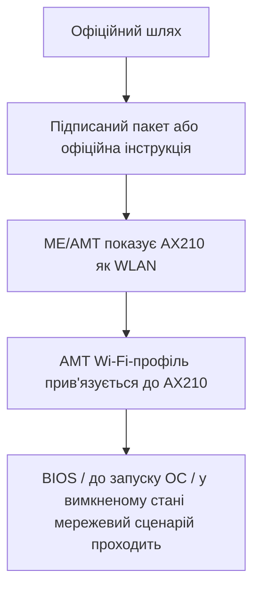

# Критерії прийнятного виробничого рішення

Цей документ описує, що саме вважалося б достатнім результатом від виробника або команди прошивки.

| Критерій | Мінімально прийнятний результат |
| --- | --- |
| Сумісність AX210 | Офіційна відповідь: підтримується або не підтримується |
| Якщо підтримується | Підписане оновлення BIOS/ME або задокументований шлях налаштування |
| Якщо не підтримується | Публічна таблиця обмежень для HP 840 G5 / Q78 / CSME 11.8 |
| Матриця WLAN | Окремі колонки для WLAN на рівні ОС і AMT/позасмуговий WLAN |
| Типи AMT-профілів | Документація підтримки WPA2-Personal/PSK, 802.1X/EAP-TLS та інших типів |
| Діагностика | Спосіб побачити, який WLAN бачить ME/AMT, без здогадок |

## Прийнятний доказ роботи



## Прийнятний доказ несумісності

Виробник також може закрити випадок негативно, якщо опублікує чітку відповідь:

```text
HP EliteBook 840 G5 / Q78 / CSME 11.8 не підтримує Intel AX210 як AMT/позасмуговий WLAN.
Підтримувані AMT/позасмуговий WLAN-модулі: ...
Підтримувані типи бездротових профілів AMT 11.8: ...
```

Така відповідь теж цінна, бо дозволяє власникам планувати оновлення без хибних очікувань.
