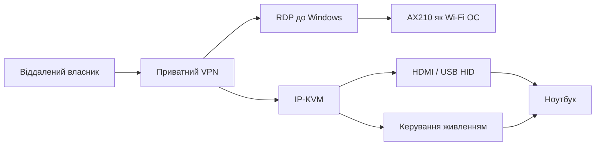

# Практичний підтримуваний маршрут доступу

Мета власника - мати реальний віддалений контроль над власним ПК: Windows, BIOS / до запуску ОС і стан вимкненого ПК. Оскільки AX210 не відображається як AMT WLAN, маршрут треба будувати не навколо непідтвердженого шляху прошивки, а навколо шарів, які реально працюють.

## Архітектура

| Рівень | Інструмент | Призначення |
| --- | --- | --- |
| Windows | AX210 + Tailscale/VPN + RDP | Повноцінна робота в ОС |
| BIOS / до запуску ОС | IP-KVM | Відео й клавіатура до запуску ОС |
| Вимкнений стан | Розумна розетка, увімкнення за подачею живлення або актуатор кнопки | Керування ввімкненням |
| Публічний доступ | Не потрібен | Доступ іде через приватний маршрут |

## Чому цей маршрут кращий для практики

| Критерій | AX210 штатний AMT Wi-Fi | IP-KVM маршрут |
| --- | --- | --- |
| Залежить від підтримки WLAN у CSME 11.8 | Так | Ні |
| Працює до Windows | Не доведено | Так, якщо BIOS приймає відео/USB |
| Працює при проблемах ОС | Не доведено | Так |
| Вимагає оновлення прошивки від виробника | Так для штатного AX210 AMT | Ні |
| Дає власнику практичний контроль зараз | Ні | Так |

## Перевірки перед використанням IP-KVM

| Перевірка | Навіщо |
| --- | --- |
| BIOS показує картинку на зовнішньому HDMI або через USB-C док-станцію | Щоб IP-KVM бачив до запуску ОС екран |
| USB-клавіатура працює в BIOS | Щоб можна було натискати F10/F9/F12/Enter |
| увімкнення за подачею живлення або актуатор кнопки працює | Щоб керувати вимкненим станом |
| VPN доступний до IP-KVM | Щоб не відкривати KVM напряму в інтернет |
