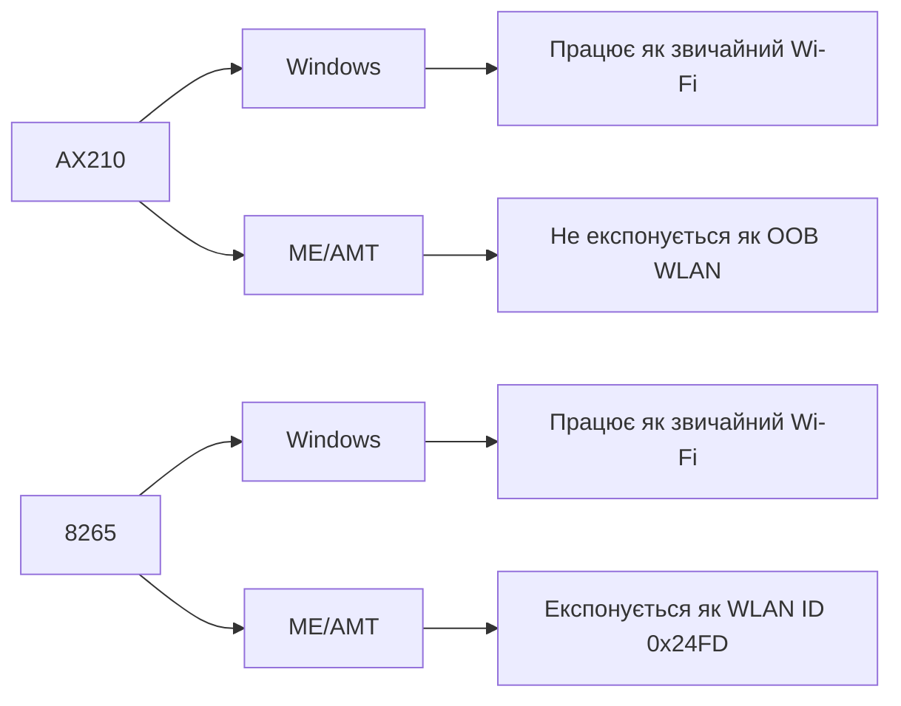

# Санітизований підсумок доказів

Цей документ зводить локальні спостереження без приватних мережевих або облікових даних.

| Категорія | Спостереження | Висновок |
| --- | --- | --- |
| Платформа | HP EliteBook 840 G5, HP Q78, Intel CSME 11.8.97.4739 LP | Досліджується конкретне покоління платформи |
| AX210 у Windows | `VEN_8086&DEV_2725`, драйвер 24.50.0.4, Wi-Fi працює | рівень ОС сумісний |
| AX210 у ME/AMT | AMT не показує AX210 як встановлений Intel WLAN | OOB-рівень не підтверджений |
| 8265 у Windows | `DEV_24FD`, драйвер 20.70.32.1, Wi-Fi працює | Контрольний модуль функціонує |
| 8265 у ME/AMT | ідентифікатор бездротового обладнання `0x24FD`, Intel Dual Band Wireless-AC 8265 | Платформа може бачити підтримуваний WLAN |
| 8265 WPA2-Personal/PSK | Створення профілю не пройшов в AMT 11.8 | Видимість WLAN не дорівнює повному домашньому AMT Wi-Fi |

## Ключове розділення

## Науково коректний висновок

Доведено не те, що "AMT Wi-Fi неможливий взагалі", а те, що:

1. AX210 не показаний ME/AMT як OOB WLAN на цій платформі.
2. 8265 показаний ME/AMT як підтримуваний WLAN.
3. AMT 11.8 WPA2-Personal/PSK-сценарій не підтверджений у цьому випадку.
4. Практичний маршрут доступу має розділяти Windows-рівень і BIOS/pre-OS/off-state рівень.
