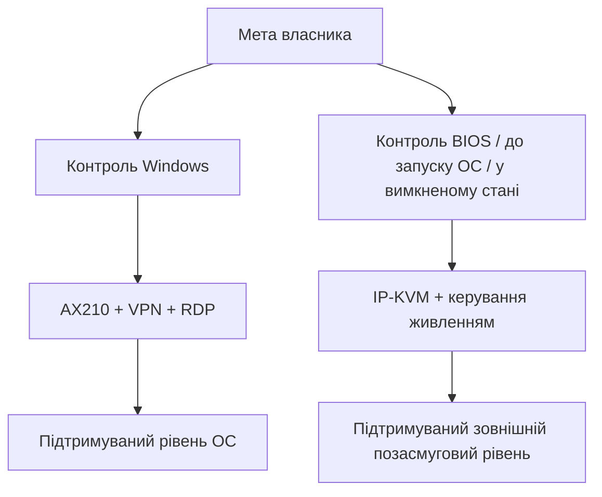

# Підтримувана рамка дослідження

Цей документ описує робочу рамку, у якій дослідження лишається перевірним і придатним для публічного обговорення.

| Напрям | Практика у цьому сховищі |
| --- | --- |
| Діагностика | Лише для читання перевірки, вивід підтримуваних інструментів, очищені таблиці |
| Віддалений доступ до Windows | Приватний VPN/Tailscale + RDP з автентифікацією |
| AMT | Штатні режими й локально автентифіковані запити |
| BIOS / до запуску ОС / у вимкненому стані | Зовнішній IP-KVM і контроль живлення |
| Публікація | Без секретів і приватних мережевих даних |

## Архітектурне рішення

Рамка не приховує негативний штатний для прошивки результат. Навпаки, вона дозволяє сформулювати проблему так, щоб її міг оцінити виробник.
